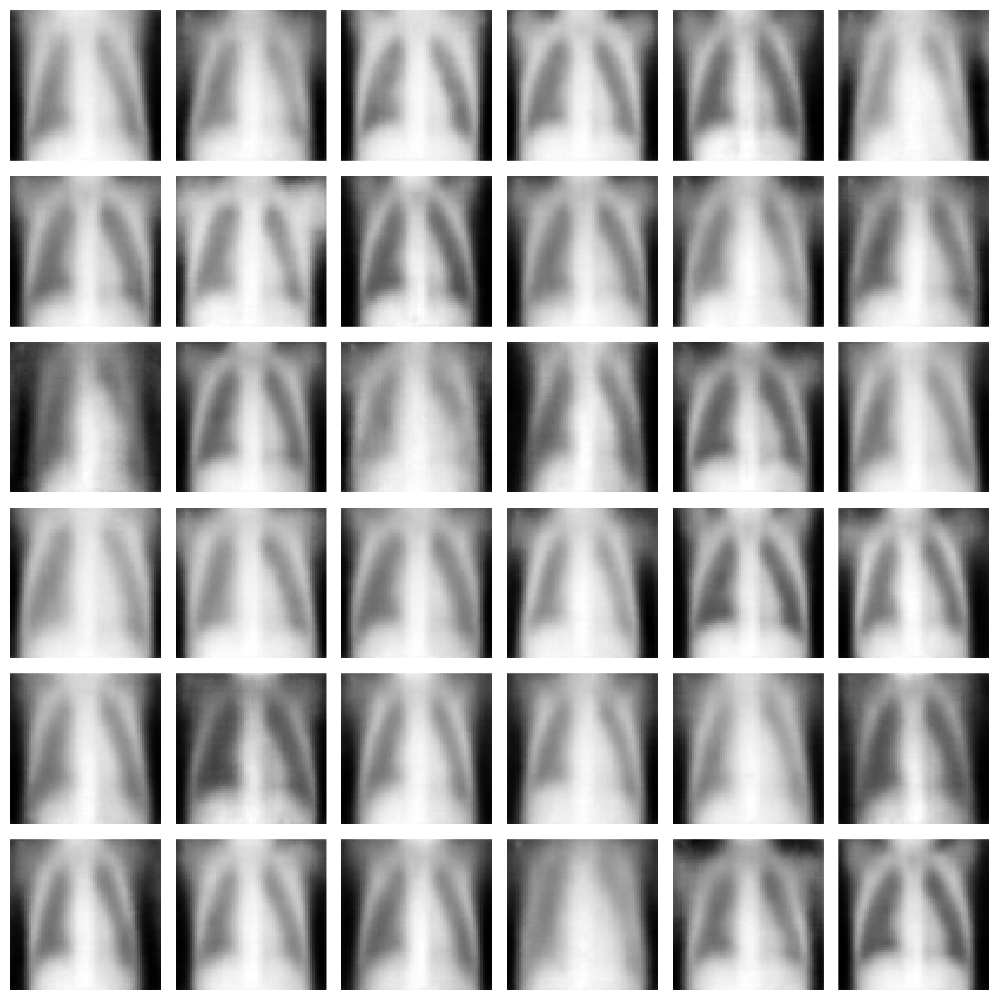

# VAE for Chest X-Ray Generation (EC285 HW1)

This repository contains the PyTorch implementation of a Convolutional Variational Autoencoder (VAE) trained on chest X-ray images for EC285 (Deep Generative Models) at UCSD.

## Model Description
The model consists of a symmetric convolutional Encoder and transposed convolutional Decoder:
* **Encoder:** 3 convolutional layers downsampling $64 \times 64 \times 1$ images to an 8192-dimensional flattened feature vector, projected to a 256-dimensional latent space ($\mu, \log \sigma^2$).
* **Sampling:** Reparameterization trick ($z = \mu + \epsilon \cdot \sigma$, $\epsilon \sim \mathcal{N}(0, I)$).
* **Decoder:** Projects $z$ back to $8 \times 8 \times 128$ and applies 3 transposed convolutions to reconstruct the $64 \times 64 \times 1$ image with a Sigmoid activation.
* **Loss:** Mean Squared Error (MSE) reconstruction loss + $\beta$-weighted KL divergence ($\beta = 0.001$).

## Hyperparameters
* Input size: $64 \times 64 \times 1$ (Grayscale)
* Latent dimension: 256
* Batch size: 64
* Optimizer: Adam (lr = 1e-3)
* Epochs: 50
* KL weight ($\beta$): 0.001

## Results
* **FID:** 0.1808 (lower is better)
* **IS:** 1.2874 (higher is better)

Evaluated using `pytorch-ignite` with Inception-V3 on the training set.

### Training Loss Curve


### Generated Samples
Samples generated from random prior noise $z \sim \mathcal{N}(0, I)$:



## How to Run

### 1. Requirements
* Python 3.8+
* PyTorch & Torchvision
* PyTorch-Ignite
* Matplotlib, Pillow

```bash
pip install torch torchvision pytorch-ignite matplotlib pillow
