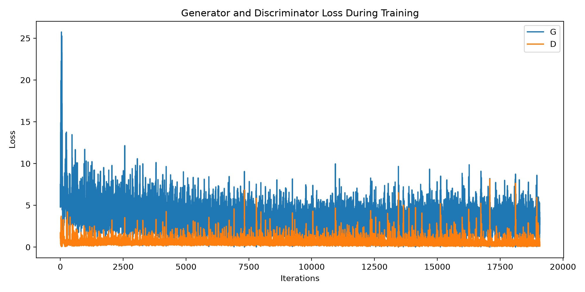
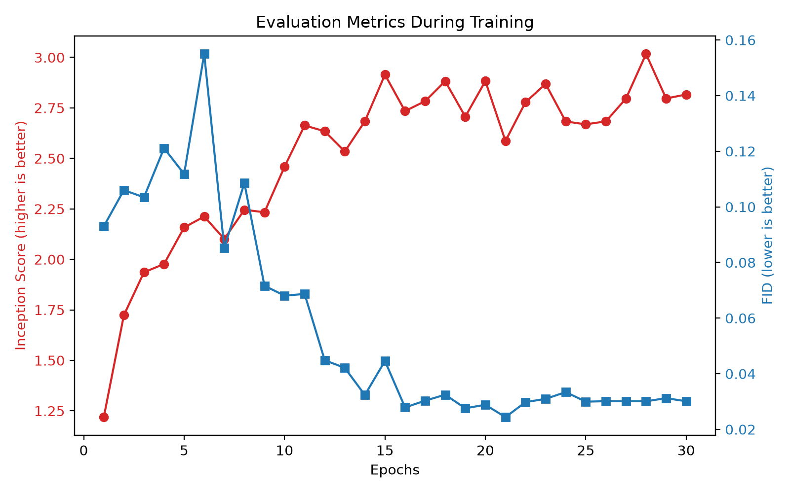
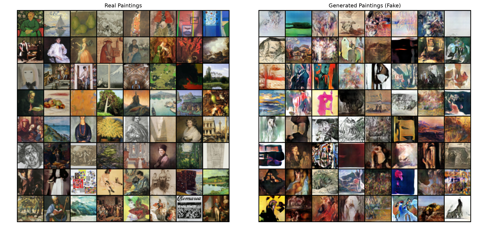

# DCGAN for WikiArt Painting Generation (EC285 HW2)

This repository contains the PyTorch implementation of a Deep Convolutional Generative Adversarial Network (DCGAN) trained on WikiArt painting images for EC285 (Deep Generative Models) at UCSD.

## Model Description
The model follows the DCGAN architecture with a transposed convolutional Generator and a strided convolutional Discriminator:
* **Generator:** Takes a 100-dimensional latent noise vector $z \sim \mathcal{N}(0, I)$ ($100 \times 1 \times 1$) and applies 5 transposed convolutional layers (`100 -> 512 -> 256 -> 128 -> 64 -> 3`) with BatchNorm and ReLU activations, ending with a Tanh activation to generate $64 \times 64 \times 3$ RGB images in $[-1, 1]$.
* **Discriminator:** Takes a $64 \times 64 \times 3$ RGB image and applies 5 convolutional layers (`3 -> 64 -> 128 -> 256 -> 512 -> 1`) with BatchNorm (intermediate layers) and LeakyReLU ($\alpha = 0.2$), ending with a Sigmoid activation to predict real/fake probability.
* **Initialization:** Convolutional layer weights are initialized from $\mathcal{N}(0, 0.02^2)$, and BatchNorm weights from $\mathcal{N}(1, 0.02^2)$ with zero bias.
* **Loss:** Binary Cross-Entropy (`BCELoss`) for minimax adversarial training of both Generator and Discriminator.

## Hyperparameters
* Input size: $64 \times 64 \times 3$ (RGB)
* Latent dimension: 100
* Batch size: 128
* Optimizer: Adam ($\text{lr} = 0.0002$, $\beta_1 = 0.5$, $\beta_2 = 0.999$)
* Epochs: 30
* Random seed: 999

## Results
* **FID:** 0.0301 (lower is better)
* **IS:** 2.8164 (higher is better)

Evaluated per epoch using `pytorch-ignite` (`FID` and `InceptionScore`) with Inception-V3 on a random subset of 3,000 training images (2,944 images evaluated with `batch_size=128` and `drop_last=True`).

### Training Loss Curve


### Evaluation Metrics (FID & IS)


### Real vs. Generated Samples
Comparison between real WikiArt paintings and samples generated from fixed prior noise $z \sim \mathcal{N}(0, I)$:



## How to Run

### 1. Requirements
* Python 3.8+
* PyTorch & Torchvision
* PyTorch-Ignite
* Matplotlib, Pillow, NumPy

```bash
pip install torch torchvision pytorch-ignite matplotlib pillow numpy
```

### 2. Dataset Setup
Download the WikiArt dataset from [Kaggle](https://www.kaggle.com/datasets/steubk/wikiart) and preprocess/cache the $64 \times 64$ RGB images as a tensor at `/tmp/wikiart_64.pt` (or update the dataset path in `gan.py`).

### 3. Training & Evaluation
Run the main script to train the DCGAN, log epoch-wise FID/IS scores, save model weights (`netG_final.pth`), and generate all figures in `./outputs/`:
```bash
python gan.py
```

## Author
* Chia-Tung Chiang (chc302@ucsd.edu)
* Student ID: 200479066